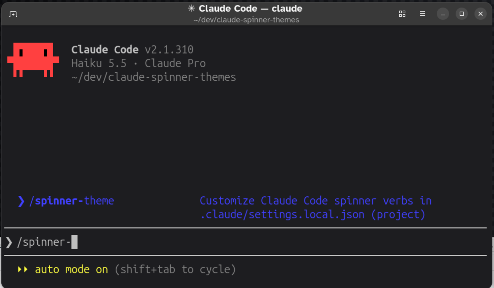
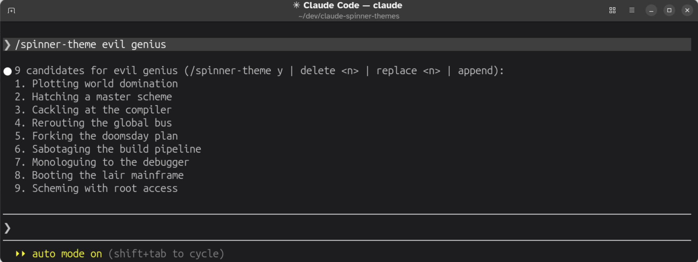
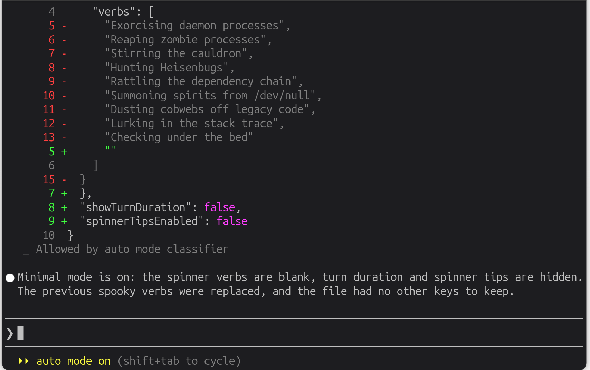

# Claude Code Spinner Themes (`/spinner-theme`)

**Slash commands** are text shortcuts used in terminal environments and messaging apps to trigger automated workflows. This repository provides `/spinner-theme`, a lightweight [Claude Code](https://code.claude.com/docs/en/overview) skill, invoked as a slash command, that customizes your active spinner verbs and companion UI settings.

Spinner verbs are a small thing, but they're on screen every time Claude works. I built this to have a little fun with them, like a Halloween theme while I wait on prompts, and to turn down the visual noise with a quiet zen mode when I want to focus.

https://github.com/user-attachments/assets/a128526c-c987-41dc-a489-addc08fcaa8d

*Figure 1: Spooky Preset Demo (video)*

## Before you begin

- **Claude Code 2.1.152 or later** (required). This is the first version that supports the `disallowed-tools` skill frontmatter this skill relies on. Older versions silently ignore the field, so the skill would run without its tool restrictions.
- **Claude Code 2.1.259 or later** (recommended). Earlier versions ignored the `model:` frontmatter in interactive sessions, so the skill ran on your session model instead of Haiku.

Check your version with:

```bash
claude --version
```

## Quick install

### Global install (available in all your projects)

```bash
REPO="https://raw.githubusercontent.com/AndrewJByrne/claude-spinner-themes/main"
DIR="$HOME/.claude/skills/spinner-theme"
FILE="SKILL.md"
mkdir -p "$DIR" && curl -fsSL "$REPO/.claude/skills/spinner-theme/$FILE" -o "$DIR/$FILE"
```

### Project-local install (current repo only)

```bash
REPO="https://raw.githubusercontent.com/AndrewJByrne/claude-spinner-themes/main"
DIR=".claude/skills/spinner-theme"
FILE="SKILL.md"
mkdir -p "$DIR" && curl -fsSL "$REPO/$DIR/$FILE" -o "$DIR/$FILE"
```

Once the above command completes, verify the install as follows.

1. Launch Claude Code from the command line with `claude`.
2. Start typing `/spinner-theme` on the command line. If everything worked, the skill displays in the command list, along with its description.

If Claude Code was already running and the `skills/` folder didn't exist when the session started, run `/reload-skills` first. After that, Claude Code picks up edits to the skill without a restart.


*Figure 2: Checking whether the skill is installed*

### Install command flags

- **`mkdir -p`** — Creates the directory path if it doesn't exist yet. If you already have the folder, it leaves your existing files untouched and exits cleanly.
- **`&&`** — Runs the download step only if the folder check succeeded.
- **`curl -fsSL`** — Quietly downloads the raw Markdown file, follows GitHub redirects, fails safely without writing an error page if offline, and saves it locally.

## Usage

### Instant presets

Apply curated 9-verb themes immediately with no confirmation step:

- `/spinner-theme spooky` — *"Exorcising daemon processes…", "Summoning spirits from /dev/null…"*
- `/spinner-theme pirate` — *"Plundering node_modules…", "Parleying with the compiler…"*
- `/spinner-theme noir` — *"Interrogating the stack trace…", "Following a cold pointer…"*
- `/spinner-theme nature` — *"Observing bugs in the wild…", "Pruning the syntax tree…"*
- `/spinner-theme sports` — *"Calling a runtime audible…", "Punting to the next sprint…"*

### Custom theme generator (interactive curation)

Pass any vibe, archetype, or genre to generate 9 custom SFW engineering puns in a compact 10-line preview before anything is written to disk:

```text
/spinner-theme evil genius
/spinner-theme auctioneer
/spinner-theme chicken little
```

Then curate the list by running the skill again with one of these actions:

- `/spinner-theme y` — Apply the list, replacing the built-in verbs.
- `/spinner-theme append` — Apply the list, adding it to the built-in verbs.
- `/spinner-theme delete <n>` — Drop candidate `<n>` and reprint the list.
- `/spinner-theme replace <n>` — Generate a new candidate for slot `<n>` and reprint the list.

Each action goes through `/spinner-theme` rather than a bare reply because the skill's model and tool settings last only one turn. Running the skill again re-applies Haiku and the tool limits.


*Figure 3: Custom Theme Generator Preview*

### Utility modes

- `/spinner-theme minimal` — Zen mode. Replaces all spinner verbs with a silent `* …` and hides tips and turn durations.
- `/spinner-theme demo` — Camera-ready mode for screen recordings. Keeps your active theme while hiding the hardcoded past-tense completion line (`✻ Sautéed for 1s`) and tip sub-line.
- `/spinner-theme reset` — Removes the custom spinner settings from your local config, restoring factory defaults while preserving any other existing rules.


*Figure 4: Minimal Mode Diff*

## Architecture & implementation

Building this skill served as a clean, self-contained reference for how Claude Code's skill frontmatter and settings precedence work together.

### Why a skill?

I first built this as a custom command in `.claude/commands/`. Before publishing it, I noticed that Claude Code has merged custom commands into skills and that the [skills documentation](https://code.claude.com/docs/en/skills) recommends skills for new work. Commands still work, but I didn't want to publish something in the older format, so I converted it. Functionally, little changed: command files support the same frontmatter, and both forms create the same `/spinner-theme` command. A skill folder also leaves room to grow, for example by moving the presets into their own file later.

### Benefits of this approach

- **Zero repo pollution:** Writes only to `.claude/settings.local.json` (kept out of version control via your global git excludes so personal UI preferences never touch team commits).
- **Guardrails, not a sandbox:** Two frontmatter fields, plus a built-in safeguard, narrow what the skill can do:
  - `disable-model-invocation: true` means the skill runs only when you type `/spinner-theme`. Claude never starts it on its own.
  - `disallowed-tools` blocks Bash, web, subagent, and notebook tools while the skill runs. It's a denylist, so any tool it doesn't name, such as MCP tools or tools added in future Claude Code versions, stays available. The skill's instructions, and your permission settings, are what keep it to its one file.
  - Claude Code treats `.claude/` as a [protected path](https://code.claude.com/docs/en/permission-modes#protected-paths), so no frontmatter can pre-approve writes to `.claude/settings.local.json`. In `auto` mode, the auto-mode classifier reviews each write. In `default` and `acceptEdits` modes, every write asks for your approval. To skip repeat prompts, choose **Yes, and allow Claude to edit files in this project's .claude folder for this session**.
- **Low-latency:** Routed to the `haiku` [model alias](https://code.claude.com/docs/en/model-config#model-aliases), so theme switches run fast at a fraction of a cent. The alias resolves to the newest Haiku on the Anthropic API and to an earlier Haiku on some other providers.
- **Instant hot-reload:** Changes take effect on the very next turn without restarting your session.

The model and tool settings apply only to the turn that runs the skill, and your session model and tools return on your next message.

### Implementation notes

- **Active spinners versus turn-completion verbs:** While custom verbs replace the active in-progress text, the post-turn summary line pulls from an internal past-tense list. Pairing custom verbs with a hidden turn duration (via the demo or minimal modes) cleanly suppresses the mismatched completion verb.
- **The zen mode behavior:** Claude Code automatically appends an ellipsis to any custom spinner string. Passing a blank string renders a clean, minimal spinner without redundant punctuation.

### Claude Code concepts glossary

- **$ARGUMENTS** — Built-in [placeholder](https://code.claude.com/docs/en/skills#available-string-substitutions) inside a skill file that captures the text passed after the slash command (for example, passing "evil genius" into the generator).
- **allowed-tools** — Frontmatter field that [pre-approves tools](https://code.claude.com/docs/en/skills#pre-approve-tools-for-a-skill) so they run without a permission prompt during the turn that invokes the skill. It does not restrict which tools are available, and it can't pre-approve writes to protected paths such as `.claude/`, which is why this skill doesn't use it.
- **disable-model-invocation** — Frontmatter field that, when `true`, stops Claude from loading the skill on its own and keeps its description out of Claude's context. Only you can start it, with `/name`.
- **disallowed-tools** — Frontmatter field that blocks tools while the skill is active, so any call to them is denied. This is the field that actually restricts tools.
- **Local settings file** — Your `.claude/settings.local.json` file is the project-local configuration layer. Claude Code automatically adds this file to your global git excludes (`core.excludesFile` / `~/.config/git/ignore`) so personal settings stay untracked.
- **Skill** — A folder containing a `SKILL.md` file, stored in `~/.claude/skills/<name>/` (personal) or `.claude/skills/<name>/` (project). Each skill registers a `/name` slash command.
- **spinnerVerbs** — The configuration object that customizes the action verbs displayed next to the animated spinner during a turn.
- **YAML frontmatter** — The header block at the top of a `SKILL.md` file that controls how the skill is invoked, which model it uses, and which tools it can reach. See the [frontmatter reference](https://code.claude.com/docs/en/skills#frontmatter-reference).

## Learn more

If you want to dive deeper into how Claude Code configurations and custom tools work under the hood, check out the official documentation:

- **[Claude Code Overview](https://code.claude.com/docs/en/overview)** — Core concepts and getting started with the terminal agent.
- **[Features Overview](https://code.claude.com/docs/en/features-overview#overview)** — How skills fit alongside hooks, subagents, MCP, and settings.
- **[Skills](https://code.claude.com/docs/en/skills)** — Creating skills, with the full [frontmatter reference](https://code.claude.com/docs/en/skills#frontmatter-reference).
- **[Model Aliases](https://code.claude.com/docs/en/model-config#model-aliases)** — What `haiku`, `sonnet`, and `opus` resolve to on each provider.
- **[Permissions](https://code.claude.com/docs/en/permissions)** — Rule syntax and how allow and deny rules interact.
- **[Protected Paths](https://code.claude.com/docs/en/permission-modes#protected-paths)** — Why writes to `.claude/` always ask for approval.
- **[Settings Hierarchy](https://code.claude.com/docs/en/settings)** — Details on how `.claude/settings.local.json` and `.claude/settings.json` inherit and override each other.
- **[The Complete Guide to Building Skills for Claude](https://resources.anthropic.com/hubfs/The-Complete-Guide-to-Building-Skill-for-Claude.pdf)** (PDF) — Anthropic's general guide to designing and writing skills.

## Acknowledgements

I used Claude Code as a sounding board while building this: it helped me structure the skill, check the settings and frontmatter against the docs, and test the skill. The idea, design, and writing are mine.

## License

MIT
